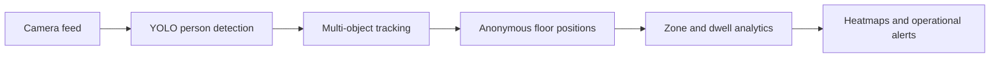

# Dwell-Time & Bottleneck Mapper

A privacy-aware retail computer vision project that turns standard in-store camera feeds into anonymous customer journeys, section-level dwell metrics, foot-traffic heatmaps, and layout bottleneck alerts.

## Problem

Retail teams often rely on manual observation to understand how customers move through a store. This is slow, inconsistent, and makes it difficult to identify congested aisles, underused sections, or layouts that reduce customer flow.

## Proposed solution

The system will use YOLO-based person detection and multi-object tracking to create temporary, anonymous track IDs. Customer positions will be mapped to configurable store sections, where an analytics engine will calculate dwell time, occupancy, movement between sections, traffic heatmaps, bottlenecks, and dead zones.

## Planned capabilities

- Anonymous customer tracking without face recognition
- Configurable store sections and floor-plan zones
- Section-wise visit counts and dwell-time distributions
- Time-weighted foot-traffic heatmaps
- Customer journey and section-transition analysis
- Sustained bottleneck and dead-zone detection
- JSON and CSV analytics reports
- Recorded video, webcam, and RTSP input support

## Current status

**Phase 1 — Planning and architecture: complete**

The problem scope, requirements, privacy boundaries, data flow, system architecture, evaluation metrics, and phased implementation plan are documented. Implementation begins in Phase 2 with the model-independent spatial analytics foundation.

## Documentation

- [Requirements and scope](docs/REQUIREMENTS.md)
- [System architecture](docs/ARCHITECTURE.md)
- [Implementation roadmap](docs/ROADMAP.md)

## Technology direction

Python, OpenCV, YOLO, multi-object tracking, NumPy, and polygon-based spatial analytics. SAM 3.1 is reserved for a later experiment if mask-based tracking measurably improves floor-position accuracy or occlusion handling.

## Privacy

The design does not use face recognition, demographic inference, or persistent customer identity. Video is intended to be processed at the edge, while downstream outputs contain temporary track events and aggregate operational metrics.

