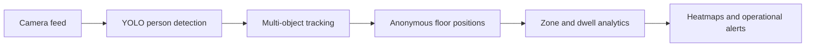

# Dwell-Time & Bottleneck Mapper

A privacy-aware retail computer vision project that turns standard in-store camera feeds into anonymous customer journeys, section-level dwell metrics, foot-traffic heatmaps, and layout bottleneck alerts.

## Problem

Retail teams often rely on manual observation to understand how customers move through a store. This is slow, inconsistent, and makes it difficult to identify congested aisles, underused sections, or layouts that reduce customer flow.

## Proposed solution

The system will use YOLO-based person detection and multi-object tracking to create temporary, anonymous track IDs. Customer positions will be mapped to configurable store sections, where an analytics engine will calculate dwell time, occupancy, movement between sections, traffic heatmaps, bottlenecks, and dead zones.



## Capabilities

- Anonymous customer tracking without face recognition
- Configurable store sections and floor-plan zones
- Section-wise visit counts and dwell-time distributions
- Time-weighted foot-traffic heatmaps
- Customer journey and section-transition analysis
- Sustained bottleneck and dead-zone detection
- JSON and CSV analytics reports
- Recorded video, webcam, and RTSP input support

## Current status

**Phase 4 — YOLO video pipeline: complete**

The project now connects YOLO11 person detection and ByteTrack multi-object tracking to the Phase 3 analytics engine. It accepts a video file, camera index, or stream URL; emits anonymous floor-position observations; and produces analytics reports, a heatmap image, runtime metrics, and an optional annotated video.

## Run the demo

Python 3.9 or newer is required. The current phase has no third-party runtime dependencies.

```bash
python3 -m venv .venv
source .venv/bin/activate
pip install .
dwell-map validate-config config/store.sample.json
dwell-map generate-demo
dwell-map analyze
python -m unittest discover -s tests -v
```

The analysis writes `report.json`, `zone_metrics.csv`, and `heatmap.csv` under `outputs/demo/`.

## Run on video

Install the optional computer-vision dependencies:

```bash
pip install '.[video]'
```

Process a recorded clip:

```bash
dwell-map video --source /path/to/store.mp4 --save-video
```

Use `--source 0` for the default webcam or pass an RTSP URL. The first run downloads the configured lightweight model weights. Video outputs are written under `outputs/video/`; `annotated.mp4` is created only with `--save-video` because it retains source imagery.

## Documentation

- [Requirements and scope](docs/REQUIREMENTS.md)
- [System architecture](docs/ARCHITECTURE.md)
- [Implementation roadmap](docs/ROADMAP.md)
- [Video pipeline and smoke test](docs/VIDEO_PIPELINE.md)

## Technology direction

Python, OpenCV, YOLO, multi-object tracking, NumPy, and polygon-based spatial analytics. SAM 3.1 is reserved for a later experiment if mask-based tracking measurably improves floor-position accuracy or occlusion handling.

## Privacy

The design does not use face recognition, demographic inference, or persistent customer identity. Video is intended to be processed at the edge, while downstream outputs contain temporary track events and aggregate operational metrics.

