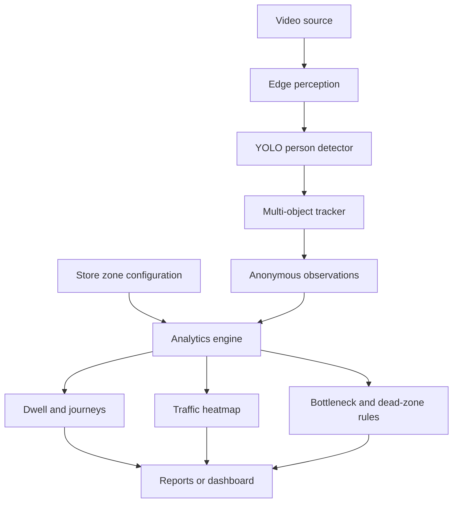

# System architecture

## High-level design



Raw frames remain inside the edge inference boundary. The analytics interface receives only a timestamp, temporary track ID, and floor-position estimate.

## Core observation contract

```json
{
  "timestamp": 12.5,
  "observations": [
    {"track_id": "42", "x": 512.0, "y": 401.2}
  ]
}
```

Coordinates use the resized camera frame, with `(0, 0)` at the top-left. The initial floor-position estimate is the bottom-center of each person bounding box.

## Component responsibilities

| Component | Responsibility |
|---|---|
| Video adapter | Read file, webcam, or RTSP frames and preserve timestamps |
| YOLO detector | Detect people in each processed frame |
| Tracker | Maintain temporary identities across nearby frames |
| Zone mapper | Assign floor positions to configured polygons |
| Analytics engine | Calculate visits, dwell, occupancy, heat, and transitions |
| Alert rules | Identify sustained congestion and low-traffic sections |
| Report sink | Export aggregate JSON/CSV results |

## Important design decisions

- Perception and analytics use a small interface so the detector can be replaced independently.
- YOLO is the initial backend because it is practical for real-time edge deployment.
- No face recognition or persistent customer identity is required.
- Image-coordinate zones are sufficient for the first single-camera release.
- Floor-plane homography will be required for physical-distance or multi-camera analytics.
- SAM 3.1 will be evaluated later only against measurable accuracy and runtime criteria.

## Evaluation

The system will report person precision/recall, tracking IDF1 or HOTA, zone-visit count error, median absolute dwell-time error, bottleneck event F1, detection delay, end-to-end FPS, p95 latency, and memory usage. Results will be reported separately for sparse, crowded, occluded, and low-light clips.

